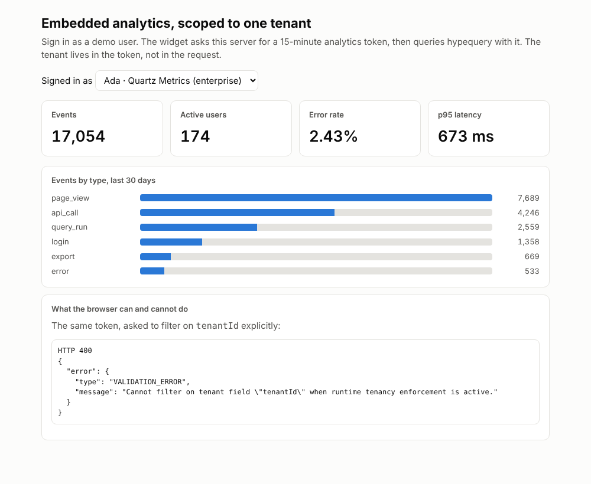

# Multi-tenant embedded analytics on ClickHouse with signed tokens

Embed tenant-scoped ClickHouse analytics in your product: your server mints a short-lived token, hypequery enforces the tenant on every query.

## Demo



```text
Signed in as Ada · Quartz Metrics (enterprise)      last 30 days of seed data

Events   Active users   Error rate   p95 latency
17,054   174            2.43%        673 ms

Events by type   page_view 7,689 · api_call 4,246 · query_run 2,559 · ...

The same token, asked to filter on tenantId explicitly:
HTTP 400  "Cannot filter on tenant field \"tenantId\" when runtime tenancy enforcement is active."
```

Switch to Grace at Relay Works and every number changes to her tenant's. Nothing in the browser ever names a tenant.

## Install

```bash
npx @hypequery/cli create multi-tenant-embedded-analytics -y
cd multi-tenant-embedded-analytics
docker compose -f ../examples/_seed/docker-compose.yml up -d --wait && pnpm seed   # or set CLICKHOUSE_* for your own ClickHouse
pnpm install
pnpm dev
```

Open http://localhost:3000. Set `HYPEQUERY_AUTH_SECRET` before deploying; the default is for the demo only.

## What it shows

- **Fail-closed tenancy on the dataset** (`analytics/datasets.ts`): `tenantKey: 'tenant_id'` means hypequery injects the tenant predicate itself, rejects queries without tenant context, and returns 400 on an explicit tenant filter.
- **Your server mints the token** (`src/app.ts`): `createAnalyticsTokenIssuer` signs a 15-minute HS256 token with the tenant in `org_id`, inside a route that already knows the user. The demo's "login" is a dropdown; yours is your session.
- **serve verifies and scopes** (`analytics/api.ts`): `createJwtStrategy` checks signature, issuer and audience; `tenant.extract` reads the tenant from the claims; `required: true` and `requiredScopes: ['read:analytics']` close the gaps.
- **An embed with no framework** (`public/embed.js`): fetch a token, call `/api/analytics/datasets/events/query`, render. Drop it in an iframe or a `<script>`.
- **Isolation proven by the smoke test** (`test/smoke.test.ts`): per-tenant totals equal raw SQL for that tenant, no token is 401, a forged token is 401, and a tenant filter is 400.

## Key file

`analytics/api.ts` is the whole security boundary:

```ts
export const issueAnalyticsToken = createAnalyticsTokenIssuer({ ...AUTH, expiresIn: '15m' });

const { serve } = initServe({
  context: () => ({ db }),
  auth: createJwtStrategy(AUTH), // sub → userId, org_id → tenantId, roles, scopes
  basePath: '/api/analytics',
});

export const api = serve({
  queryBuilder: db,
  tenant: { extract: (auth) => auth.tenantId, required: true },
  datasets: {
    events: { dataset: Events, requiredScopes: ['read:analytics'], maxLimit: 200, cache: 10_000 },
  },
});
```

## Architecture

```text
browser (public/embed.js)                 your server (Hono)                              ClickHouse
────────────────────────                  ─────────────────────────────────────────       ──────────
POST /api/analytics/token  ──session──▶   issueAnalyticsToken({ tenantId })  ◀─ user store
        ◀── { token (15m, org_id=153) }
POST /api/analytics/datasets/events/query
  Authorization: Bearer <token>   ─────▶  createJwtStrategy ─▶ tenant.extract ─▶ dataset(tenantKey)
                                           └─ SELECT ... FROM events WHERE tenant_id = 153 ... ─▶
```

## Adapt it

- **Your identity provider.** Replace `createJwtStrategy({ secret })` with `createJwtStrategy({ jwksUri, issuer, audience })` to accept tokens from Auth0, Clerk or Cognito directly, and map claims with `mapClaims` if your tenant claim is not `org_id`.
- **Roles.** Add `requiredRoles: ['admin']` to a dataset entry, or a second dataset for admin-only measures. Roles ride in the token.
- **Cross-tenant reporting.** Internal jobs can run `analytics.execute(Events, query, { runtime: { tenant: { scope: 'all' } } })` server-side. Never expose that path to a browser.
- **More datasets.** Register `subscriptions` or `users` with the same `tenantKey`; the widget picks them up by name.
- **React.** Swap `public/embed.js` for `@hypequery/react` hooks with a `token` resolver, as in the Next.js dashboard example.
- **Hosting.** It is a plain Node server; `pnpm build && pnpm start` runs it anywhere Node runs.

## Related recipes

- [p95-latency](../../recipes/p95-latency): the p95 tile, explained.

## Related examples

- [nextjs-dashboard](../nextjs-dashboard): the same dataset pattern with typed React hooks.

Versions used: ClickHouse 25.8, `@hypequery/serve` 0.x, `@hypequery/datasets` 0.29 and Hono 4.
