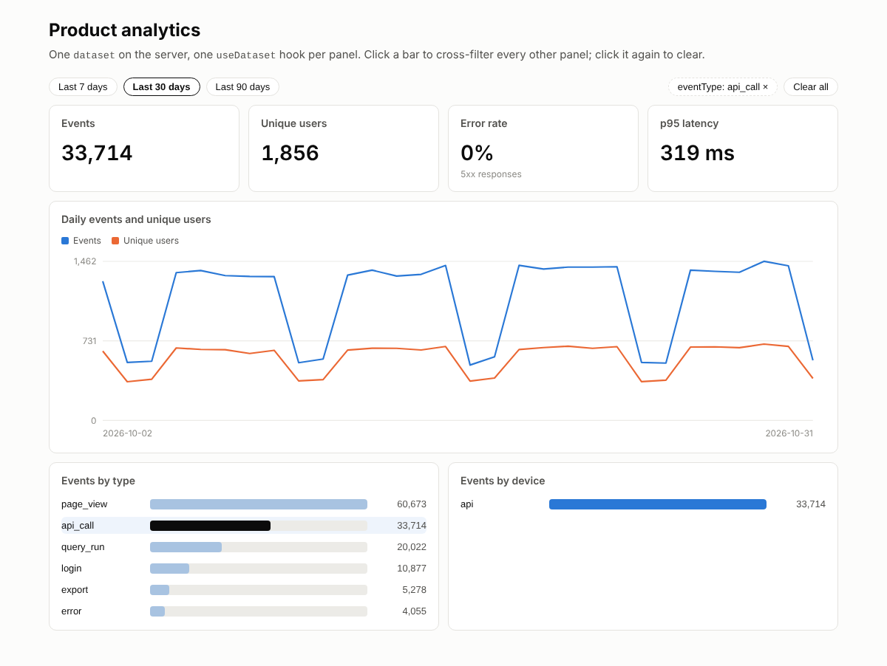

# Next.js dashboard on ClickHouse with cross-filtering

A Next.js 16 dashboard over ClickHouse: one typed dataset, a serve endpoint, React hooks, and click-to-filter across every panel.

## Demo



Four KPI tiles, a daily line chart and two breakdown panels, all reading the
seed's one million events through a single `POST /api/analytics/datasets/events/query`
endpoint. Click `api_call` in "Events by type" and the tiles, the chart and the
device breakdown re-query with that filter; click it again to clear.

```text
Last 30 days (2026-10-02 to 2026-10-31, seed data)

Events        Unique users    Error rate    p95 latency
  134,619       2,143           2.4 %         872 ms

Daily events and unique users      ───────── two-series line chart, hover for values
Events by type   ▇▇▇▇▇▇▇▇▇ page_view 60,673      Events by device  ▇▇▇▇▇▇▇▇ desktop 65,707
                 ▇▇▇▇▇ api_call 33,714                             ▇▇▇▇ api 33,714
                 ▇▇▇ query_run 20,022                              ...
```

## Install

```bash
npx hypequery create nextjs-dashboard -y
cd nextjs-dashboard
docker compose -f ../examples/_seed/docker-compose.yml up -d --wait && pnpm seed   # or set CLICKHOUSE_* for your own ClickHouse
pnpm install
pnpm dev
```

Open http://localhost:3000.

## What it shows

- **One dataset, many panels** (`analytics/datasets.ts`): dimensions, measures, a derived error rate and a p95 defined once; the server validates every request against it.
- **A serve endpoint in an App Router route handler** (`app/api/analytics/[...path]/route.ts`): `createFetchHandler(api.handler)` mounts dataset queries at `/api/analytics/datasets/events/query`.
- **Typed React hooks without shipping server code** (`lib/analytics.ts`): `createAnalyticsHooks<AnalyticsApi>` uses `import type` plus a generated route manifest, so `@hypequery/clickhouse` never reaches the browser bundle.
- **Cross-filtering as plain state** (`lib/filters.ts`, `components/dashboard.tsx`): one state object, each panel derives its own filters and leaves out its own dimension so it keeps all its bars.
- **Charts in plain SVG and CSS**: a two-series line chart with hover crosshair and an accessible table twin, horizontal bars as buttons. No chart library.

## Key file

`components/dashboard.tsx` owns the only state on the page and hands each panel the
filters it should apply:

```tsx
const [state, setState] = useState<CrossFilterState>(initialState);
const select = (dimension: Dimension, value: string) =>
  setState((current) => toggleSelection(current, dimension, value));

<KpiTiles filters={toDatasetFilters(state)} />
<Timeseries filters={toDatasetFilters(state)} />
<BreakdownBars dimension="eventType" filters={toDatasetFilters(state, 'eventType')}
  selected={state.selections.eventType} onSelect={(v) => select('eventType', v)} />
<BreakdownBars dimension="device" filters={toDatasetFilters(state, 'device')}
  selected={state.selections.device} onSelect={(v) => select('device', v)} />
```

Each panel is a `useDataset('events', { ...selection, filters } as const)` call. TanStack
Query caches by input, so toggling a filter back and forth is instant.

## Architecture

```text
browser                               Next.js (Node runtime)                 ClickHouse
──────────────────────────────        ─────────────────────────────────────  ──────────
components/*  ── useDataset ──▶ POST /api/analytics/datasets/events/query
  (lib/analytics.ts: hooks +           app/api/analytics/[...path]/route.ts
   generated route manifest)             └─ analytics/api.ts  serve({ datasets: { events } })
                                              └─ analytics/datasets.ts  dataset('events', …) ──▶ events (seed)
```

`hypequery generate:manifest analytics/api.ts` runs in `prebuild` and writes
`analytics/hypequery-manifest.json`, the only server artifact the client imports.

## Adapt it

- **Your own table.** Point `analytics/datasets.ts` at it, rename dimensions to your product language, and the panels follow: they only reference semantic names.
- **Tenant scoping.** Add `tenantKey: 'tenant_id'` to the dataset and resolve the tenant in `initServe({ context })` from the session. Every query is then scoped server-side. See the multi-tenant example.
- **Auth.** Wrap the route with serve's auth strategies (`/docs/authentication`); the hooks accept a `token` resolver.
- **More filters.** Add a dimension to `Dimension` in `lib/filters.ts` and drop another `BreakdownBars`. The type-checker tells you if the dataset does not publish it.
- **Faster at scale.** Point the dataset at a rollup table instead of the raw events; the materialized view example shows how, and the panels do not change.

## Related recipes

- p95 latency (coming in this series)

## Related examples

- [materialized-view-rollups](../materialized-view-rollups): pre-aggregate the same events and swap the dataset source.

Tested on ClickHouse 25.8, Next.js 16.4, React 19.3, `@hypequery/serve` 0.x, `@hypequery/react` 0.8.
